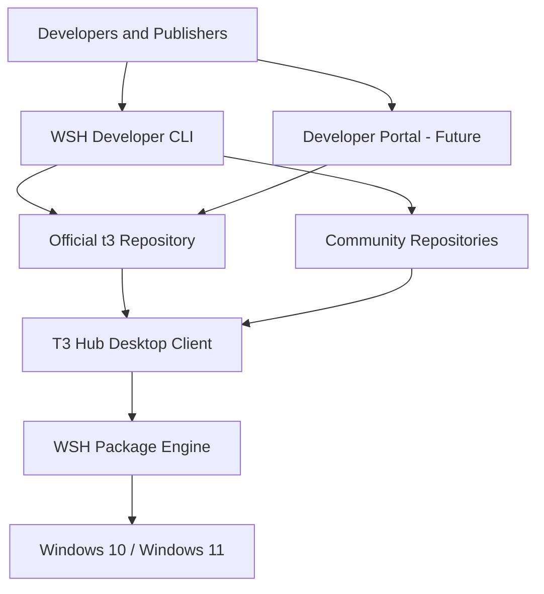

# t3 Software Hub --- Architecture

**Document status:** Proposed architecture\
**Working project name:** t3 Software Hub\
**Package specification:** WSP (t3 Software Package Specification)\
**Package manager / engine:** t3SH Engine\
**Developer CLI:** t3SH CLI\
**Initial platform:** Windows 10 and Windows 11\
**Distribution model:** Hybrid --- official and community repositories\
**Software policy:** Open-source and commercial applications\
**Branding:** Company-branded, community-driven, open-source platform

------------------------------------------------------------------------

## 1. Project vision

t3 Software Hub is an open-source software distribution ecosystem
for Windows. It allows users to discover, install, update, repair
(future scope), and uninstall desktop applications through one desktop
client.

Independent developers and organizations can publish software through
their own repositories or submit packages to the official t3
repository. The client consumes a common package manifest and repository
format, so developers do not need to create a separate installer
experience for every application.

The platform itself is open-source. Applications distributed through it
may be open-source or commercial, subject to the applicable licenses and
repository policies.

### Core goals

-   Provide one consistent Windows desktop client for discovering and
    managing applications.
-   Support both official and third-party community repositories.
-   Define a versioned, documented package manifest standard (WSP).
-   Support common Windows distribution formats: EXE, MSI, ZIP/portable,
    and later MSIX.
-   Verify downloaded artifacts and repository metadata before
    installation.
-   Make publishing accessible through a developer CLI and documented
    workflow.
-   Avoid requiring a central cloud backend for the initial release.
-   Support offline installation from previously downloaded or locally
    supplied packages where practical.

### Non-goals for the first MVP

-   Payments, subscriptions, or a commercial app store checkout.
-   Mandatory user accounts or cloud login.
-   A centralized proprietary package hosting service.
-   Arbitrary script execution as a default installation mechanism.
-   Guaranteed bypass of Windows Defender, SmartScreen, UAC, or other
    Windows security controls.

------------------------------------------------------------------------

## 2. High-level architecture

The system is divided into five main areas:

1.  **Windows Desktop Client** --- user interface and application
    management.
2.  **WSH Engine** --- package discovery, validation, downloads,
    installation, updates, and uninstall orchestration.
3.  **Repository Network** --- official and community catalogs,
    manifests, and release metadata.
4.  **Developer Tooling** --- WSH CLI for creating, validating, and
    publishing package manifests.
5.  **Developer Portal** --- optional future web interface for publisher
    onboarding, package submission, and moderation.



### Main design principle

The desktop client and repositories must remain independent. The client
should consume any repository that conforms to the published repository
and manifest specifications and passes the configured trust policy.

------------------------------------------------------------------------

## 3. Technology stack

  -----------------------------------------------------------------------
  Area                    Proposed technology     Responsibility
  ----------------------- ----------------------- -----------------------
  Desktop framework       Tauri 2                 Windows desktop
                                                  application shell

  Frontend                React + TypeScript      UI and user
                                                  interactions

  UI icons                Lucide React            Interface icons

  Frontend state          Zustand                 Local UI state

  Server/cache state      TanStack Query          Async catalog and query
                                                  state

  Backend                 Rust                    Package engine and
                                                  system integration

  Local database          SQLite                  Installed apps,
                                                  repositories,
                                                  operations, settings

  Manifest format         YAML                    Human-editable package
                                                  definitions

  Repository index        JSON                    Catalog and manifest
                                                  references

  HTTP                    reqwest                 Repository and artifact
                                                  downloads

  Async runtime           Tokio                   Async Rust operations

  Integrity               SHA-256                 Artifact integrity
                                                  verification

  Metadata signatures     Ed25519                 Repository metadata
                                                  authenticity

  Version handling        semver                  Version comparison

  Developer CLI           Rust + Clap             Package authoring and
                                                  publishing

  Hosting, initial        GitHub Releases +       Artifacts and
                          static HTTPS / GitHub   repository metadata
                          Pages                   

  Client updater          Tauri updater           Updating the desktop
                                                  client
  -----------------------------------------------------------------------

Dependency versions should be pinned and checked for compatibility when
the initial workspace is created. This document defines the
architectural choices, not a guarantee that every crate version is
mutually compatible without testing.

------------------------------------------------------------------------

## 4. Desktop client

The desktop client is the user-facing application. It should provide a
simple, keyboard-friendly interface and keep privileged operations in
the Rust backend.

### Initial screens

-   **Home:** featured applications, recently updated packages, and
    repository status.
-   **Discover:** search, categories, tags, filters, and package
    details.
-   **Installed:** locally installed applications and detected versions.
-   **Updates:** available package updates and update history.
-   **Repositories:** add, enable, disable, refresh, and inspect
    repositories.
-   **Settings:** download cache, install defaults, security
    preferences, and logs.

### Frontend responsibilities

-   Render catalog and package details.
-   Collect user choices and confirmations.
-   Show download and installation progress.
-   Display warnings, errors, and operation history.
-   Invoke narrowly scoped Tauri commands.

### Backend responsibilities

-   Validate all inputs received from the frontend.
-   Fetch and validate repository metadata.
-   Resolve package versions and artifacts.
-   Verify signatures and hashes.
-   Download and install packages.
-   Manage local inventory and operation logs.
-   Enforce permissions and installation policies.

The frontend must never directly execute downloaded installers or
construct arbitrary shell commands.

------------------------------------------------------------------------

## 5. WSH package engine

The WSH Engine is a modular Rust component. It should be reusable by the
desktop client and, where appropriate, the developer CLI.

### Suggested internal modules

  -----------------------------------------------------------------------
  Module                              Responsibility
  ----------------------------------- -----------------------------------
  `manifest-schema`                   Parse and validate WSP manifests

  `repository-client`                 Fetch repository metadata and
                                      manifests

  `signature-verifier`                Verify signed metadata and trust
                                      roots

  `download-engine`                   Download, resume where supported,
                                      and cache artifacts

  `package-core`                      Package identity, version,
                                      platform, and dependency models

  `install-engine`                    Dispatch installation to
                                      format-specific adapters

  `uninstall-engine`                  Execute registered uninstall
                                      procedures safely

  `package-database`                  Persist inventory and operation
                                      state

  `security-policy`                   Apply repository and installation
                                      trust policies

  `logging`                           Structured operation and diagnostic
                                      logs
  -----------------------------------------------------------------------

### Installer adapters

The engine should use an adapter interface so new formats can be added
without changing the overall package workflow.

  -----------------------------------------------------------------------
  Adapter                 Initial / later support Notes
  ----------------------- ----------------------- -----------------------
  EXE                     Initial                 Requires a declared
                                                  installer profile and
                                                  arguments

  MSI                     Initial                 Use Windows Installer
                                                  mechanisms

  ZIP portable            Initial                 Extract to a managed
                                                  application directory

  Portable executable     Initial                 Manage files and
                                                  shortcuts without
                                                  running a setup program

  MSIX                    Later                   Use supported Windows
                                                  package deployment APIs

  Other custom formats    Later                   Only after a reviewed
                                                  adapter contract exists
  -----------------------------------------------------------------------

NSIS, Inno Setup, and WiX are commonly used to produce EXE/MSI
installers. They are not all separate package formats; they should be
handled through compatible EXE/MSI profiles.

### Installation workflow

1.  User selects a package.
2.  Client retrieves the manifest from an enabled repository.
3.  Engine validates schema, package identity, version, OS,
    architecture, and required fields.
4.  Engine checks repository metadata signature and trust policy.
5.  Engine downloads the selected artifact over HTTPS.
6.  Engine verifies the artifact SHA-256 hash against signed manifest
    metadata.
7.  Client displays publisher, installer type, requested scope, and
    privilege requirements.
8.  Engine invokes the correct adapter with validated arguments.
9.  Engine records the result and detected installation information in
    SQLite.
10. Client refreshes the installed inventory and reports success or
    failure.

A package should not be installed if required integrity checks fail. A
hash proves that an artifact matches the manifest; it does not by itself
prove who published it or whether it is safe.

------------------------------------------------------------------------

## 6. Hybrid repository architecture

The ecosystem supports two repository classes.

### 6.1 Official repository

Operated by t3 Solutions.

Expected responsibilities:

-   Review package submissions.
-   Apply publisher verification policies.
-   Review metadata and installation behavior.
-   Maintain package versions and release history.
-   Respond to security reports.
-   Remove or revoke malicious or compromised packages.
-   Publish signed repository metadata.

Official repository inclusion is a curation decision, not a claim that
every application is risk-free.

### 6.2 Community repositories

A developer or organization may host a repository using GitHub Pages,
another static HTTPS host, or a compatible server.

The desktop client should allow users to add a repository URL, inspect
its publisher and signing identity, and choose whether to trust it.
Adding a repository must not silently grant it unrestricted trust.

### 6.3 Repository layout

``` text
repository/
├── repository.json
├── index.json
├── index.sig
├── manifests/
│   └── publisher/
│       └── package-name/
│           ├── 1.0.0.yaml
│           └── 1.1.0.yaml
└── icons/
    └── package-name.png
```

Suggested file responsibilities:

-   `repository.json`: repository identity, display name, format
    version, metadata endpoint, and signing-key information.
-   `index.json`: package IDs, available versions, manifest paths, and
    compact discovery metadata.
-   `index.sig`: detached signature over the exact index bytes or a
    clearly specified canonical representation.
-   `manifests/`: versioned WSP package manifests.
-   `icons/`: optional package artwork.

The repository specification must define canonical serialization,
signature encoding, key identifiers, expiry/rollback handling, and key
rotation before production use. Do not sign ambiguous JSON or YAML
representations.

### 6.4 Example repository configuration

``` json
{
  "id": "t3-community",
  "name": "t3 Community",
  "url": "https://example.com/repository/",
  "type": "community",
  "enabled": true,
  "trust_policy": "user-approved"
}
```

The `trust_policy` value is illustrative. Trust must be determined by
cryptographic verification and local user policy, not by a
repository-supplied label such as `verified`.

### 6.5 Repository refresh

1.  Fetch repository metadata over HTTPS.
2.  Validate repository format and identity.
3.  Verify the index signature against a locally trusted key.
4.  Check metadata version, expiry, and rollback policy.
5.  Parse the index and expose available packages.
6.  Fetch individual manifests only when needed.
7.  Verify manifest authenticity through the signed index or a
    separately defined signature scheme.

------------------------------------------------------------------------

## 7. t3SP --- t3 Software Package Specification

WSP is the platform's versioned package manifest standard.

The first specification version is `1.0`. The schema should be
maintained independently from the desktop UI and should include formal
JSON Schema or equivalent validation rules, examples, compatibility
rules, and security requirements.

### 7.1 Example manifest

``` yaml
schema_version: "1.0"

package:
  id: "developer.devstudio"
  name: "DevStudio"
  version: "1.0.0"
  description: "Lightweight code editor and workspace toolkit"
  publisher: "Example Developer"
  license: "MIT"
  homepage: "https://example.com/devstudio"
  repository: "https://github.com/developer/devstudio"
  categories:
    - Developer Tools
    - Utilities
  tags:
    - code-editor
    - dev-tools

platform:
  os: windows
  architectures:
    - x64
  minimum_windows_version: "10"

release:
  channel: stable
  release_date: "2026-10-31"

artifacts:
  - id: windows-x64
    type: exe
    url: "https://github.com/developer/devstudio/releases/download/v1.0.0/setup.exe"
    sha256: "REPLACE_WITH_64_CHARACTER_SHA256"
    size: 25000000

installation:
  type: exe
  artifact: windows-x64
  scope: user
  arguments:
    - /VERYSILENT
    - /SUPPRESSMSGBOXES
    - /NORESTART
  timeout_seconds: 600

uninstallation:
  type: registry
  detect:
    registry_path: "Software\\Microsoft\\Windows\\CurrentVersion\\Uninstall\\DevStudio"

updates:
  strategy: version
  channel: stable
```

This is an illustrative starting point, not yet a complete production
schema. In particular, EXE installer profiles, uninstall detection,
argument rules, registry handling, exit-code interpretation, and scope
semantics must be formally specified.

### 7.2 Required manifest concepts

  Field / concept       Purpose
  --------------------- --------------------------------------------------
  `schema_version`      Selects the WSP schema version
  `package.id`          Stable, globally unique package identifier
  `package.name`        Display name
  `package.version`     Semantic version
  `package.publisher`   Publisher display identity
  `platform`            Supported OS and architectures
  `artifacts`           Downloadable release files
  `sha256`              Artifact integrity digest
  `installation`        Installer type, scope, and adapter configuration
  `uninstallation`      Uninstall detection and procedure
  `updates`             Update channel and strategy

### 7.3 Specification rules to define before production

-   Package IDs must be stable and collision-resistant, with repository
    ownership rules.
-   Versions must follow a documented versioning policy.
-   URLs must use HTTPS unless a future, explicit local-file scheme is
    defined.
-   SHA-256 must be exactly 64 hexadecimal characters.
-   Artifact size should be declared and checked where available.
-   Unknown critical fields must cause validation failure;
    forward-compatible optional fields must be explicitly defined.
-   Installer arguments must be passed as an argument array, never
    concatenated into a shell command.
-   Environment-variable expansion and path interpolation must be
    restricted and documented.
-   Manifest fields must not allow arbitrary command execution.
-   Architecture and Windows version constraints must be checked before
    installation.
-   Uninstall behavior must be declared or safely detected; the client
    must not guess an uninstall command.

------------------------------------------------------------------------

## 8. Security and trust model

Security is a core product requirement because community repositories
can distribute software from independent publishers.

### 8.1 Repository authenticity

-   Each repository has a stable identity and one or more signing keys.
-   Repository metadata is signed.
-   The client verifies signatures using locally trusted public keys.
-   Key rotation, expiration, revocation, and recovery are specified.
-   Metadata includes versioning and expiry information to reduce
    rollback and freeze attacks.
-   Official repository keys are distributed through a trusted client
    release process.

Ed25519 is the proposed signature algorithm for the initial design. The
signing format and canonicalization rules must be specified before
implementation.

### 8.2 Artifact integrity and publisher identity

-   Verify SHA-256 after download and before execution or extraction.
-   Prefer Authenticode-signed Windows executables and MSI files.
-   Where available, verify the Authenticode publisher identity against
    manifest and repository policy.
-   Clearly distinguish repository trust, publisher identity, artifact
    integrity, and application safety.
-   A valid signature does not guarantee that software is harmless.

### 8.3 Installation safety

-   Default to per-user installation where supported.
-   Request elevation only when required and explain why.
-   Never bypass UAC, Defender, SmartScreen, or enterprise security
    policy.
-   Do not execute arbitrary PowerShell, BAT, or shell scripts by
    default.
-   Use reviewed, typed installation adapters.
-   Validate installer arguments and avoid shell interpretation.
-   Restrict extraction paths to prevent ZIP path traversal.
-   Use temporary directories and clean up safely.
-   Show publisher, repository, version, download source, and requested
    permissions before installation.
-   Log actions without storing secrets.

### 8.4 Reporting and response

-   Provide package and publisher reporting.
-   Maintain package removal and key revocation procedures.
-   Preserve audit history for official repository changes.
-   Provide a way to disable or remove a compromised repository.
-   Define an incident response contact and security disclosure process.

### 8.5 Windows reputation

Open-source source code does not automatically prevent Windows security
warnings. The project should use legitimate code signing for distributed
client binaries, build reproducibly where practical, submit genuine
false positives to Microsoft, and build publisher reputation over time.
No installer can guarantee that SmartScreen or antivirus products will
never flag a file.

------------------------------------------------------------------------

## 9. Local data model

SQLite stores client state locally. The initial database should include
the following tables:

  -----------------------------------------------------------------------
  Table                               Main purpose
  ----------------------------------- -----------------------------------
  `repositories`                      Configured repository URLs,
                                      identities, enabled state, and
                                      trust references

  `packages`                          Cached package metadata

  `package_versions`                  Available package versions and
                                      manifest references

  `installations`                     Installed package ID, version,
                                      scope, path, and detection data

  `artifacts`                         Cached artifact metadata, hashes,
                                      and file paths

  `downloads`                         Download history and status

  `operations`                        Install, update, and uninstall
                                      operation records

  `trusted_publishers`                Local publisher trust decisions and
                                      certificate/key references

  `trusted_repository_keys`           Repository public keys and key
                                      status

  `settings`                          Client preferences
  -----------------------------------------------------------------------

Database migrations must be versioned. The database should not be
treated as the only source of truth for whether an application is
installed; the engine should reconcile recorded state with Windows
installation records and filesystem state where appropriate.

------------------------------------------------------------------------

## 10. Developer CLI and publishing workflow

The WSH CLI makes publishing consistent and lowers the barrier for
independent developers.

### Proposed commands

``` bash
wsh init
wsh validate
wsh package
wsh publish
wsh search
wsh info
```

### Expected workflow

1.  Developer creates or builds a Windows application.
2.  Developer uploads release artifacts to GitHub Releases or their own
    HTTPS host.
3.  Developer runs `wsh init` to create a WSP manifest.
4.  Developer completes package metadata and installation configuration.
5.  Developer runs `wsh validate`.
6.  CLI checks schema, version, URLs, artifact availability, hash, and
    platform declarations.
7.  Developer publishes the manifest and index update to their own
    repository, or submits a pull request to the official repository.
8.  The desktop client discovers the package after the repository
    metadata is updated and trusted.

### Official repository workflow

-   Pull request submission.
-   Automated schema and artifact checks.
-   Review of publisher identity and installation behavior.
-   Security and policy review.
-   Maintainer approval.
-   Signed repository index release.
-   Audit trail for changes and removals.

### Community repository workflow

-   Developer hosts the repository.
-   Developer signs repository metadata with their own key.
-   User adds the repository and reviews its identity.
-   User explicitly chooses whether to trust it.
-   Client verifies metadata and artifacts according to its policy.

------------------------------------------------------------------------

## 11. GitHub monorepo structure

Start with a monorepo to simplify coordinated development and
Codex-assisted implementation. Split components into separate
repositories only when independent release and maintenance needs justify
it.

``` text
t3-software-hub/
│
├── apps/
│   ├── desktop/
│   │   ├── src/
│   │   │   ├── components/
│   │   │   ├── pages/
│   │   │   │   ├── Home/
│   │   │   │   ├── Discover/
│   │   │   │   ├── Installed/
│   │   │   │   ├── Updates/
│   │   │   │   ├── Repositories/
│   │   │   │   └── Settings/
│   │   │   ├── hooks/
│   │   │   ├── services/
│   │   │   └── types/
│   │   └── src-tauri/
│   │       └── src/
│   │           ├── commands/
│   │           ├── database/
│   │           ├── security/
│   │           ├── download/
│   │           ├── installer/
│   │           ├── updater/
│   │           └── main.rs
│   │
│   └── developer-cli/
│       └── src/
│           ├── commands/
│           ├── manifest/
│           └── main.rs
│
├── crates/
│   ├── package-core/
│   ├── manifest-schema/
│   ├── repository-client/
│   ├── signature-verifier/
│   ├── download-engine/
│   ├── install-engine/
│   ├── uninstall-engine/
│   └── package-database/
│
├── specification/
│   ├── manifest-v1/
│   ├── repository-format/
│   ├── security-model/
│   └── examples/
│
├── repositories/
│   └── official/
│       ├── repository.json
│       ├── index.json
│       └── manifests/
│
├── docs/
│   ├── architecture.md
│   ├── developer-guide.md
│   ├── repository-guide.md
│   ├── security.md
│   └── installation-guide.md
│
├── tests/
│   ├── manifest-tests/
│   ├── installer-tests/
│   └── security-tests/
│
├── .github/
│   └── workflows/
│       ├── build.yml
│       ├── test.yml
│       └── release.yml
│
├── LICENSE
├── README.md
└── CONTRIBUTING.md
```

### Suggested future repository split

  Repository               Purpose
  ------------------------ --------------------------------------
  `software-hub`           Windows desktop client
  `package-spec`           WSP manifest and repository standard
  `package-cli`            Developer CLI
  `official-repository`    Curated official catalog
  `community-repository`   Community catalog or directory
  `developer-portal`       Future web portal
  `documentation`          User and developer documentation

------------------------------------------------------------------------

## 12. MVP development roadmap

The first release should prove the complete package lifecycle with a
small, safe feature set. Avoid building accounts, payments,
subscriptions, or a large web portal before installation and update
behavior is reliable.

### Milestone 1 --- Desktop foundation

-   Create Tauri 2 + React + TypeScript application.
-   Set up Rust backend commands.
-   Add SQLite initialization and migrations.
-   Build navigation and placeholder screens.
-   Establish structured logging and error handling.
-   Produce a working Windows development build.

**Deliverable:** A working Windows desktop shell with persistent local
settings.

### Milestone 2 --- Manifest and repository

-   Define WSP v1 schema and validation tests.
-   Define repository metadata and index format.
-   Load a local test repository.
-   Fetch a static HTTPS repository.
-   Display catalog, search results, and package details.
-   Add repository management UI.

**Deliverable:** The client can browse packages from official and
community-style test repositories.

### Milestone 3 --- Installation engine

-   Implement download manager and cache.
-   Verify artifact SHA-256.
-   Implement ZIP portable adapter.
-   Implement MSI adapter.
-   Implement EXE adapter using explicit, reviewed installer profiles.
-   Record installation state and logs.
-   Test success, failure, cancellation, and interrupted downloads.

**Deliverable:** Install test applications from a repository with
integrity verification.

### Milestone 4 --- Application management

-   Detect installed versions.
-   Compare installed and repository versions.
-   Implement update workflow.
-   Implement safe uninstall using declared or detected uninstall
    metadata.
-   Add operation history and diagnostics.

**Deliverable:** Install, update, and uninstall supported test packages.

### Milestone 5 --- Developer publishing

-   Build WSH CLI.
-   Implement `init` and `validate`.
-   Generate and update repository indexes.
-   Add metadata signing and verification.
-   Document community repository hosting.
-   Add official repository pull-request checks.

**Deliverable:** An independent developer can publish a package using
the documented workflow.

### Milestone 6 --- Public beta

-   Review security boundaries and installer adapters.
-   Test on clean Windows 10 and Windows 11 environments.
-   Add code signing for official client releases when available.
-   Publish documentation and contribution guidelines.
-   Create issue templates and a security reporting process.
-   Release a public beta.

**Deliverable:** A usable open-source beta for community testing.

### MVP acceptance criteria

-   Client installs and runs on supported Windows 10/11 systems.
-   Official repository can be browsed.
-   A community repository can be added with explicit trust
    configuration.
-   Catalog search and package details work.
-   EXE, MSI, and ZIP packages install through their adapters.
-   SHA-256 mismatch blocks installation.
-   Installed version and installation scope are displayed.
-   Supported updates and uninstall procedures work.
-   Errors and operation logs are available.
-   No security-control bypass is used.

------------------------------------------------------------------------

## 13. Suggested initial dependencies

### Frontend

``` bash
npm create vite@latest desktop -- --template react-ts
cd desktop
npm install
npm install lucide-react zustand @tanstack/react-query
npm install @tauri-apps/api
npm install -D @tauri-apps/cli
```

Tauri project scaffolding and prerequisites should follow the official
Tauri 2 documentation for the target Windows development environment.

### Rust crate candidates

  Crate             Purpose
  ----------------- -----------------------------------
  `serde`           Serialization and deserialization
  `serde_json`      JSON support
  `serde_yaml_ng`   YAML parsing
  `tokio`           Async runtime
  `reqwest`         HTTP client
  `sqlx`            SQLite access and migrations
  `sha2`            SHA-256 hashing
  `ed25519-dalek`   Ed25519 signatures
  `clap`            CLI argument parsing
  `semver`          Semantic version parsing
  `zip`             ZIP archive handling
  `thiserror`       Error types
  `tracing`         Structured logging

Choose and pin compatible crate versions during workspace setup. Review
maintenance status and security advisories before adopting dependencies.

------------------------------------------------------------------------

## 14. Important architectural decisions

  Decision             Initial choice
  -------------------- ----------------------------------------
  Operating system     Windows 10/11
  Repository model     Hybrid
  Software types       Open-source and commercial
  Branding             t3 Solutions
  Client framework     Tauri 2
  Frontend             React + TypeScript
  Backend              Rust
  Local database       SQLite
  Package format       WSP YAML
  Catalog format       JSON
  Artifact hosting     GitHub Releases or HTTPS
  Repository hosting   GitHub Pages or static HTTPS
  Repository trust     Signed metadata and local trust policy
  Artifact integrity   SHA-256
  Metadata signature   Ed25519
  First release        Windows desktop MVP
  Development model    GitHub monorepo

### Additional product principles

1.  **No mandatory central server:** users can consume compatible
    repositories without relying on a t3-operated API.
2.  **Repository independence:** the client should not hard-code the
    official repository as its only source.
3.  **Explicit trust:** adding a repository and trusting its packages
    are distinct user decisions.
4.  **Least privilege:** prefer per-user installation and request
    elevation only when necessary.
5.  **Typed adapters:** avoid arbitrary scripts and shell command
    execution.
6.  **Transparent operations:** show download source, publisher,
    version, and installation results.
7.  **Open specifications:** publish WSP and repository-format
    documentation so other clients and tools can implement them.
8.  **Commercial compatibility:** package distribution must respect each
    application's license and publisher permissions.

------------------------------------------------------------------------

## 15. Recommended implementation order

Build in this order:

1.  Create the GitHub monorepo and project documentation.
2.  Scaffold the Tauri 2 + React + TypeScript desktop app.
3.  Add the Rust command boundary and SQLite database.
4.  Define and test the WSP manifest schema.
5.  Implement a local static repository reader.
6.  Build the Discover screen.
7.  Implement download and SHA-256 verification.
8.  Implement ZIP installation first, then MSI and EXE adapters.
9.  Add installed inventory, updates, and uninstall.
10. Add signed repository metadata and the developer CLI.
11. Publish the first public beta.

**Recommended first coding milestone:** a runnable Windows desktop
application with React navigation, Rust backend communication, SQLite
initialization, and a placeholder Discover page. Do not begin with the
full installer engine; first establish a stable project foundation.

------------------------------------------------------------------------

## 16. References

-   Tauri: https://tauri.app/
-   Tauri 2 documentation: https://v2.tauri.app/
-   React: https://react.dev/
-   Rust: https://www.rust-lang.org/
-   SQLite: https://www.sqlite.org/
-   WinGet CLI: https://github.com/microsoft/winget-cli
-   Scoop: https://github.com/ScoopInstaller/Scoop
-   Homebrew: https://github.com/Homebrew/brew
-   Inno Setup: https://jrsoftware.org/isinfo.php
-   WiX Toolset: https://github.com/wixtoolset/wix
-   Microsoft app signing and distribution guidance:
    https://learn.microsoft.com/windows/apps/package-and-deploy/

------------------------------------------------------------------------

**Document note:** This is a proposed architecture and implementation
baseline. Before production release, the WSP schema, repository
signature format, key lifecycle, installer adapter contracts, uninstall
rules, and threat model must be formalized and tested. Security review
is required before accepting arbitrary community packages.
