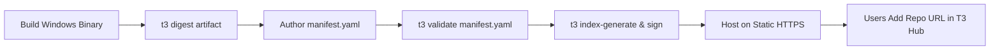

# T3 Hub Package Publishing & Distribution Guide

**Specification:** T3 Software Package Specification (`T3P v1.0`)  
**CLI Tool:** `t3` (T3 Hub Developer CLI)  
**Target Platform:** Windows 10 / Windows 11 (x64, arm64, x86)  

---

## 1. Overview & Core Philosophy

T3 Hub provides a modern, transparent, and reproducible software distribution ecosystem for Windows. Traditional Windows software distribution has long suffered from two persistent problems:

1. **Installer Fragility:** Custom, opaque installer executables bundled with arbitrary installer scripts frequently break or leave orphaned files and registry clutter.
2. **Security & Antivirus False Positives:** Windows Defender and SmartScreen heuristics frequently flag unfamiliar binaries, custom script wrappers, and unexpected privilege escalations as potentially unwanted or malicious software.

T3 Hub solves these problems fundamentally through a **declarative, verifiable architecture**:
- **Zero Arbitrary Scripts:** Package manifests contain purely declarative metadata, parameters, and paths. No custom PowerShell or CMD batch scripts are ever executed during installation.
- **Strict Cryptographic Integrity:** All binaries are verified against pre-computed SHA-256 hashes prior to execution or extraction.
- **Ed25519 Repository Signatures:** Repositories cryptographically sign their catalog indices and release manifests, ensuring tamper-proof delivery.
- **Per-User Isolation by Default:** Installations default to user-level scope (`%LOCALAPPDATA%`), avoiding unnecessary UAC elevation prompts that trigger security alerts.

---

## 2. Preventing Windows Defender & SmartScreen False Positives

When publishing software for Windows, follow these official T3 Hub recommendations to maintain clean reputation with Microsoft Defender and SmartScreen:

### Rule 1: Use Declarative Clean Installers
- **Preferred Formats:**
  1. Standard **MSI** installers (`msiexec.exe /i <artifact> /qn /norestart`).
  2. Well-known installer engines: **Inno Setup** (`/VERYSILENT /SUPPRESSMSGBOXES /NORESTART`), **NSIS** (`/S`), or **WiX**.
  3. Clean **ZIP** portable archives extracted directly to isolated application folders (`%LOCALAPPDATA%\T3Hub\Apps\<package-id>`).
- **Never wrap your payload in batch scripts (`.bat`, `.cmd`), PowerShell scripts (`.ps1`), or self-extracting SFX scripts.** Windows Defender heuristics disproportionately flag nested script execution from temp directories.

### Rule 2: Prefer Per-User Scope (`scope: user`)
- Configure your installer to install into the user profile (`%LOCALAPPDATA%\Programs\<app>` or `%LOCALAPPDATA%\T3Hub\Apps\<app>`) rather than `C:\Program Files`.
- Avoid requesting administrator permissions unless the application strictly requires low-level kernel drivers or system-wide services.
- Unnecessary elevation prompts trigger SmartScreen warning barriers on newly published executables with low initial reputation.

### Rule 3: Authenticode Digital Code Signing
- While T3 Hub pins and validates SHA-256 hashes independently, signing your binaries with an **Authenticode Code Signing Certificate** (or EV Certificate) builds immediate reputation with Microsoft SmartScreen.
- Use `signtool.exe`:
  ```powershell
  signtool sign /fd SHA256 /tr http://timestamp.digicert.com /td SHA256 /sha1 <THUMBPRINT> "path\to\app-setup.exe"
  ```

### Rule 4: Cryptographic Hash Pinning
- Always compute and pin the exact 64-character SHA-256 hash using `t3 digest`:
  ```bash
  t3 digest "dist/MyApp-Setup-1.0.0.exe"
  ```
- If you rebuild your binary, always re-digest and publish a new version manifest. Never overwrite an artifact under the same URL with different bytes.

---

## 3. Developer CLI Reference (`t3`)

The `t3` CLI is the official developer tool for authoring, linting, signing, and indexing T3 Hub packages.

### Building & Installing the CLI

From the project root:
```bash
cargo build --release --bin t3
```
The compiled binary is available at `target/release/t3.exe`. Add it to your `PATH` or invoke it directly.

### Commands

#### 1. `t3 init`
Scaffolds a new compliant `manifest.yaml` with best-practice defaults:
```bash
t3 init --id "developer.devstudio" --name "DevStudio" --version "1.0.0" --publisher "Acme Corp" --type exe --scope user
```

**Options:**
- `--id <ID>`: Reverse-DNS package identifier (e.g., `company.product`).
- `--name <NAME>`: Human-readable application name.
- `--version <SEMVER>`: Semantic version (SemVer 2.0.0).
- `--publisher <NAME>`: Publisher or developer identity.
- `--type <TYPE>`: `exe`, `msi`, or `zip` (default: `exe`).
- `--scope <SCOPE>`: `user` or `machine` (default: `user`).
- `--url <URL>`: Download URL for the artifact.
- `--sha256 <HASH>`: SHA-256 checksum (64 hex characters).
- `-o, --output <FILE>`: Output file path (default: `manifest.yaml`).

#### 2. `t3 digest`
Computes the streaming SHA-256 checksum and exact byte size of an installer artifact and prints a ready-to-paste YAML snippet:
```bash
t3 digest "build/MyApp-Setup-1.0.0.exe"
```
**Example output:**
```text
File Details:
  Path:        build/MyApp-Setup-1.0.0.exe
  Size:        28450120 bytes (27.13 MB)
  SHA-256:     9f86d081884c7d659a2feaa0c55ad015a3bf4f1b2b0b822cd15d6c15b0f00a08
  Detected:    exe

YAML Artifact Snippet (paste into manifest):
------------------------------------------------------------
artifacts:
  - id: "windows-x64-exe"
    type: "exe"
    url: "https://example.com/releases/MyApp-Setup-1.0.0.exe"
    sha256: "9f86d081884c7d659a2feaa0c55ad015a3bf4f1b2b0b822cd15d6c15b0f00a08"
    size: 28450120
------------------------------------------------------------
```

#### 3. `t3 validate`
Performs comprehensive validation of a manifest file or all manifests in a directory tree:
```bash
t3 validate "repositories/official/manifests/developer/devstudio/1.2.0.yaml"
# Or validate an entire directory:
t3 validate "repositories/official/manifests"
```

**Validation Checks Performed:**
- `schema_version`: Must strictly equal `"1.0"`.
- `package.id`: Must follow reverse-DNS naming convention (`[a-zA-Z0-9_-]+(\.[a-zA-Z0-9_-]+)+`).
- `package.version`: Must strictly comply with SemVer 2.0.0.
- `platform.os`: Must equal `"windows"`, supported architectures (`x64`, `x86`, `arm64`).
- `artifacts`: Verifies exact 64-hex SHA-256 checksums and valid `https://` URLs.
- `installation.arguments`: Audits arguments to ensure no shell pipe/redirection operators (`|`, `&`, `;`, `>`, `<`, `` ` ``) are present.
- `uninstallation`: Validates uninstallation configurations (`registry`, `zip_directory`, `msi`).

#### 4. `t3 keygen`
Generates a new Ed25519 cryptographic keypair:
```bash
t3 keygen --output "keys/repository-keys.json"
```
- **Public Key:** Safe to share; embed in your `repository.json`.
- **Secret Key:** Private; used to sign your repository's `index.json`. Never commit to source control.

#### 5. `t3 sign`
Generates a detached Ed25519 signature (128 hex characters) for a file:
```bash
t3 sign "repositories/community/index.json" --key "<SECRET_KEY_HEX>" --output "repositories/community/index.json.sig"
```

#### 6. `t3 verify`
Verifies an Ed25519 detached signature against a file:
```bash
t3 verify "repositories/community/index.json" --sig "repositories/community/index.json.sig" --public-key "<PUBLIC_KEY_HEX>"
```

#### 7. `t3 index-generate`
Scans a repository's `manifests/` directory, validates all packages, resolves the latest SemVer releases, and compiles the master `index.json`:
```bash
t3 index-generate --repo-dir "repositories/official"
# Or generate and sign in one command:
t3 index-generate --repo-dir "repositories/community" --sign-key "<SECRET_KEY_HEX>"
```

---

## 4. Manifest Specification (`T3P v1.0`)

Below is the complete reference structure for a package manifest:

```yaml
schema_version: "1.0"

package:
  id: "developer.devstudio"
  name: "DevStudio"
  version: "1.2.0"
  description: "Modern lightweight workspace editor and developer toolkit with syntax highlighting and Git workflow."
  publisher: "T3 Community"
  license: "MIT"
  homepage: "https://devstudio.tools"
  repository: "https://github.com/developer/devstudio"
  categories:
    - Developer Tools
    - Utilities
  tags:
    - editor
    - ide
    - code

platform:
  os: "windows"
  architectures:
    - "x64"
  minimum_windows_version: "10"

release:
  channel: "stable"
  release_date: "2026-10-31"

artifacts:
  - id: "windows-x64-installer"
    type: "exe"
    url: "https://github.com/developer/devstudio/releases/download/v1.2.0/DevStudio-Setup-1.2.0.exe"
    sha256: "9f86d081884c7d659a2feaa0c55ad015a3bf4f1b2b0b822cd15d6c15b0f00a08"
    size: 28450120

installation:
  type: "exe"
  artifact: "windows-x64-installer"
  scope: "user"
  arguments:
    - "/VERYSILENT"
    - "/SUPPRESSMSGBOXES"
    - "/NORESTART"
  timeout_seconds: 600

uninstallation:
  type: "registry"
  detect:
    registry_path: "Software\\Microsoft\\Windows\\CurrentVersion\\Uninstall\\DevStudio"

updates:
  strategy: "version"
  channel: "stable"
```

---

## 5. Publishing Workflows

### Workflow A: Publishing via Community Repository

Community repositories allow developers to distribute software directly from GitHub Pages, Cloudflare R2, AWS S3, or any static HTTPS web server without central gatekeepers.



1. **Host Artifacts:** Upload your release binaries (`.exe`, `.msi`, or `.zip`) to your release server or GitHub Releases.
2. **Compute Digest:** Run `t3 digest <binary>` to obtain the SHA-256 and size.
3. **Generate Manifest:** Place your manifest at `manifests/<category>/<app-name>/<version>.yaml`.
4. **Generate Index:** Run `t3 index-generate --repo-dir . --sign-key <SECRET_KEY>`.
5. **Publish:** Push your `repository.json`, `index.json`, `index.json.sig`, and `manifests/` to your HTTPS server.
6. **Share:** Provide users with your repository URL (e.g., `https://repo.example.com/`). Users add it via T3 Hub's **Repositories** screen.

---

### Workflow B: Contributing to the Official T3 Hub Repository

1. **Fork the Repository:** Fork `https://github.com/t3hub/t3hub` on GitHub.
2. **Create Branch:** Create a feature branch `git checkout -b add-<app-id>`.
3. **Add Manifest:** Add your manifest to `repositories/official/manifests/<category>/<app>/<version>.yaml`.
4. **Validate:**
   ```bash
   t3 validate repositories/official/manifests
   ```
5. **Re-generate Index:**
   ```bash
   t3 index-generate --repo-dir repositories/official
   ```
6. **Submit PR:** Submit a Pull Request. Automated CI checks will verify manifest syntax, artifact URL accessibility, and hash consistency before review by the T3 Hub maintainers.
